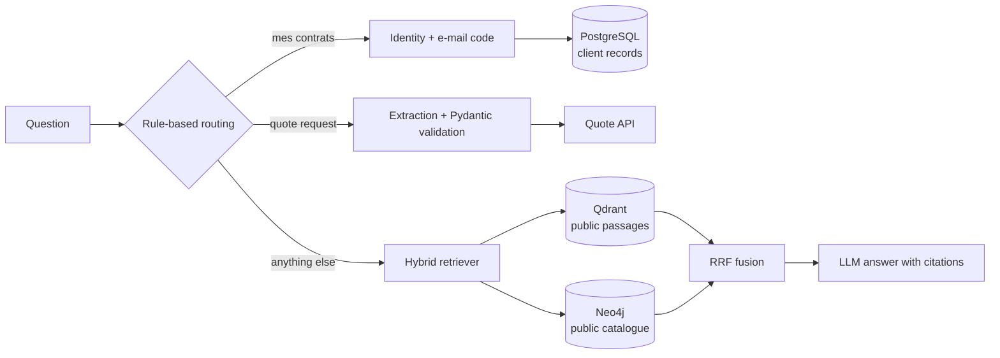
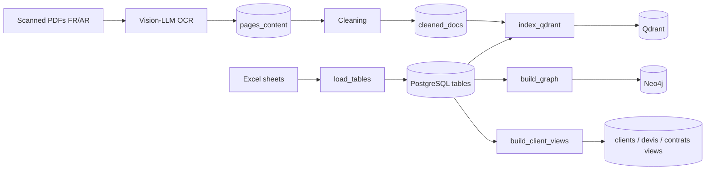

# BHbot – Hybrid RAG assistant for insurance

[](https://github.com/maryamom/rag-hybrid-assurance/actions/workflows/tests.yml)

A customer assistant for an insurer, built for the **BH Assurance hackathon** (September 2025) and refactored in October 2026.
It answers questions from scanned insurance documents (French and Arabic) and the product catalogue, gives authenticated
clients access to their own contracts, and computes car-insurance quotes.

[Demo video of the hackathon version](https://www.linkedin.com/posts/mariem-omrani_insurtech-ai-hybridrag-activity-7371467482135441408-H8f2) ·
[Solution write-up (French)](docs/Explication.pdf)

## What it does

| Question | What happens |
| --- | --- |
| *« Que couvre la garantie bris de glace ? »* | Hybrid search in a vector index (Qdrant) and a knowledge graph (Neo4j), fused with Reciprocal Rank Fusion, then an answer that cites its sources |
| *« Je veux voir mes contrats »* | Identity check (name + phone), a 6-digit code e-mailed to the address on file, then answers from that client's records only |
| *« Je veux un devis pour ma voiture »* | Vehicle details extracted and validated, missing ones asked for, then a call to the quote API |

## Architecture





### Design choices

- **Vision-LLM OCR.** The source PDFs are low-quality scans mixing French and Arabic, where classic OCR fails. Each page is sent to a vision model (`OCR_MODEL`, GPT-4o-mini by default) through OpenRouter.
- **Public and private data never mix.** Qdrant and Neo4j contain only public knowledge: documents, guarantees, products, FAQ. Client records stay in PostgreSQL and are read after authentication, filtered on the client's id. Both retrievers also filter on an allow-list of public types, so a client record indexed by mistake still can't be returned.
- **Reciprocal Rank Fusion.** Cosine scores and Lucene scores are not comparable; RRF merges the two rankings using ranks only, and favors passages that both sources rank high. Sources are queried in parallel, with a timeout each.
- **Rule-based routing.** Intent detection runs before any LLM call: it is free, deterministic, unit-tested, and keeps working when the LLM is disabled.
- **Graceful degradation.** Without an LLM key, the assistant lists the most relevant passages. If one database is down, the other still answers, and `/api/health` reports what is missing.

### Security

- Each browser gets its own session (HttpOnly cookie): conversation history and authentication state are never shared.
- Verification codes come from `secrets`, are stored hashed, bound to the session that requested them, expire after 10 minutes and lock after 3 wrong attempts. Identity attempts are limited too.
- The reply is identical whether or not a client exists, and never shows the e-mail address, so the chat can't be used to find out who is a client.
- Logs contain the intent and latency only, never the question, an identity or a CIN. 8-digit numbers are masked before a message is kept in history.
- The web page inserts every server response as text, never as HTML.

## Hackathon version and refactor

The code written during the hackathon is tagged [`hackathon-2025-09`](https://github.com/maryamom/rag-hybrid-assurance/tree/hackathon-2025-09).
An audit in October 2026 found that it could not start (a missing module, conflicting dependency pins, a JavaScript syntax error in the chat page), that the graph search could return client records without authentication, and that the ingestion scripts filling Qdrant and Neo4j were missing.
The refactor fixed these, split the code into modules, rewrote the ingestion pipeline and added 70+ tests.

## Quick start

Requirements: Python 3.11+, Docker.

```bash
git clone https://github.com/maryamom/rag-hybrid-assurance.git
cd rag-hybrid-assurance
cp .env.example .env            # set POSTGRES_PASSWORD and NEO4J_PASSWORD
docker compose up -d postgres neo4j qdrant
pip install -r requirements.txt
```

Put the hackathon files in `data/raw/` (see [data/README.md](data/README.md)), then build the databases:

| Step | Command | Result |
| --- | --- | --- |
| 1. Load the Excel files | `python -m ingestion.load_tables data/raw/tables` | one PostgreSQL table per sheet |
| 2. Check them | `python -m ingestion.check_data` | what was found, what is missing |
| 3. OCR the PDFs (needs `OPENROUTER_API_KEY`) | `python data_extraction/simple_pdf_processor.py data/raw/pdfs` | `documents`, `pages_content` |
| 4. Clean the text | `python -m ingestion.clean_documents --export data/processed/cleaned_docs.jsonl` | `cleaned_docs` (+ a JSONL to commit) |
| 5. Client views | `python -m ingestion.build_client_views` | `clients`, `devis`, `contrats` |
| 6. Vector index | `python -m ingestion.index_qdrant` | Qdrant collection |
| 7. Knowledge graph | `python -m ingestion.build_graph` | Neo4j graph + full-text index |

Steps 3–4 can be replaced by `python -m ingestion.clean_documents --import data/processed/cleaned_docs.jsonl` once the OCR output is committed, so nobody else has to pay for OCR.

Start the API and open http://localhost:8005:

```bash
python -m uvicorn src.api.main:app --port 8005
```

`OPENROUTER_API_KEY` is optional. To try client authentication locally without an SMTP server, set `AUTH_DEMO_MODE=true`: codes are then printed in the server console. Use it with the hackathon's fictitious clients only.

## Evaluation

```bash
python -m eval.evaluate eval/questions.jsonl
```

This compares vector-only, graph-only and hybrid retrieval: hit rate @5, MRR, and median and 95th-percentile latency, printed as a Markdown table. Questions are written from the documents, with the phrases a correct passage must contain (format in [eval/questions.example.jsonl](eval/questions.example.jsonl)).

## Tests

```bash
pip install -r requirements-test.txt
python -m pytest
```

Unit tests cover routing, identity parsing, quote extraction, authentication, fusion, sessions and the HTTP API, with fakes for the databases and the LLM. Integration tests run against real PostgreSQL and Neo4j in [GitHub Actions](.github/workflows/tests.yml); locally, set `TEST_POSTGRES_PORT` to run them on a separate `bhbot_test` database.

## Project structure

```
src/
  api/          FastAPI app, session cookie, static chat page
  auth/         client authentication (OTP by e-mail)
  core/         orchestrator, routing, prompts, quotes, sessions
    retrievers/ Qdrant, Neo4j and hybrid (RRF) retrievers
ingestion/      Excel → PostgreSQL → Qdrant / Neo4j pipeline
data_extraction/ OCR of scanned PDFs with a vision model
eval/           retrieval evaluation
tests/          unit and integration tests
docs/           architecture notes, API reference, solution write-up
```

## Limitations

- Sessions and verification codes are kept in memory: fine for one process; several workers would need Redis.
- Identity attempts are limited per session; a public deployment would also need rate limiting per IP.
- Intent routing uses keyword rules: robust for the hackathon's question set, but a classifier would generalize better.
- Quotes depend on an external API provided for the hackathon.

## License

MIT – Mariem Omrani
